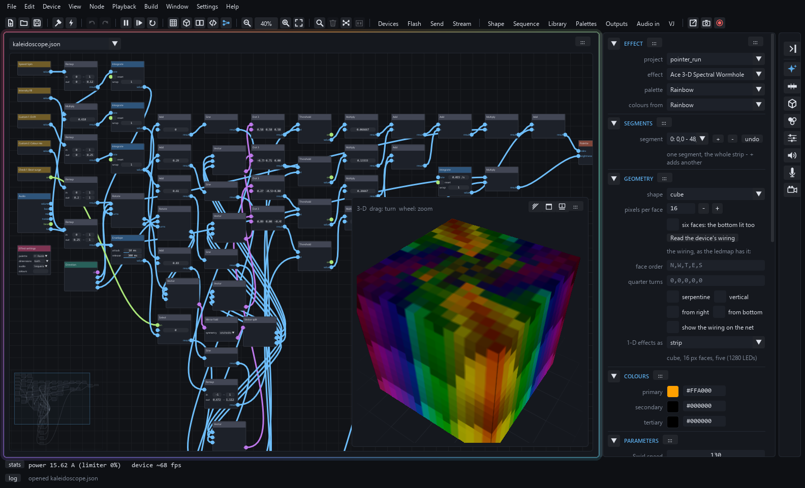
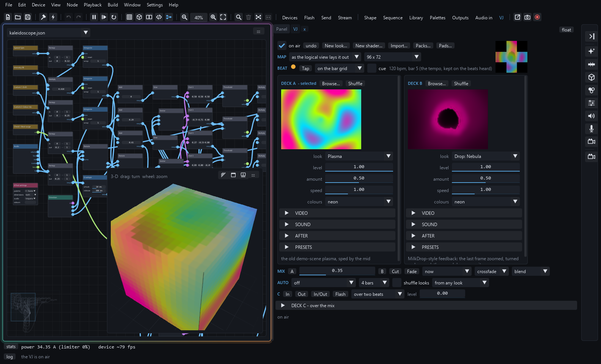
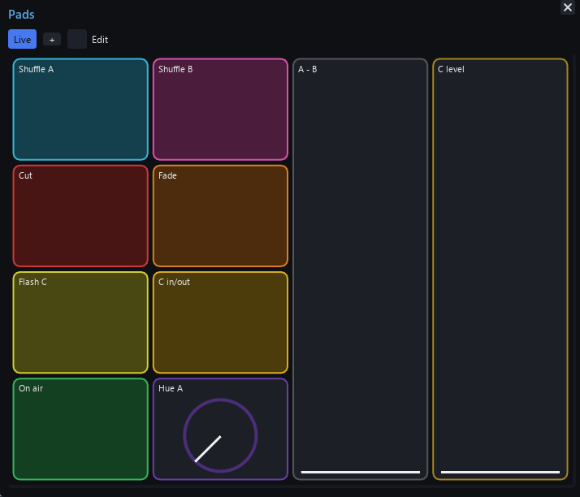
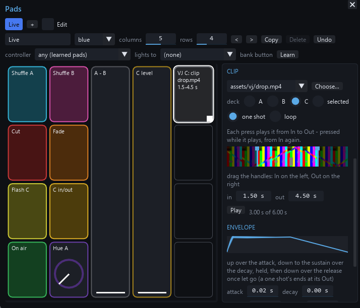
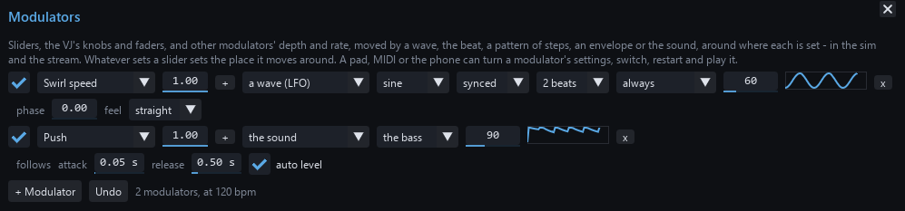

# WLED Effects Studio

Node graphs and C++ compiled into [WLED](https://github.com/Aircoookie/WLED)
effects, previewed on a simulated cube, sphere, matrix, strip or any shape
you build, with synthetic or live audio - then sent to the device as a
script, as its settings, or flashed into the firmware.



- **[GUIDE.md](GUIDE.md)** - how to use it, from the first run to a show on the device
- **[TUTORIAL.md](TUTORIAL.md)** - a first effect, node by node
- **[NODES.md](NODES.md)** - every node
- **[STUDIO.md](STUDIO.md)** - the design, the history and the roadmap

## What it does

**Make effects.** Wire nodes - noise, waves, fields, the sound, maths,
geometry - or write C++, and the studio compiles it into a WLED effect as
you go. It runs on a simulated cube, sphere, matrix, strip or any shape you
build in the shape editor, beside WLED's own stock effects and palettes, and
hears synthetic beats, an audio file or live input.

**Put it on the lights.** Send an effect to a device as a script, as its
settings and presets, or flash it into the firmware. Lay out a show on the
sequence's timeline - steps, blends, automation, song sections found in the
audio - then send it as presets and a playlist, export an FSEQ for Falcon
Player, or render it to video.

**Play it live: the VJ.** Three decks - A and B across a crossfader, C over
the mix - with cuts, fades and an auto-mix on the bar grid. Each deck shows
a look: shaders, MilkDrop presets, fractal flames you breed with Mutate,
text, a picture, a WLED effect, or video from a file, a webcam, the screen,
a stream or your phone's camera. **Packs...** installs themed packs of
MilkDrop presets and Shadertoy shaders from the gallery.



**Pads, MIDI and the phone.** Banks of buttons, faders, knobs, XY and
pressure pads drive anything: cuts and fades, looks and presets, a deck's
knobs, the effect's sliders, on air. Play them with the mouse, from a pad
controller (its pads and lights learned), or from the phone's /pads page
with several fingers at once. MIDI learn reaches the same targets.

<p>


</p>

- **Video clips on pads**, like a sampler's: a pad plays part of a video
  file - drag its In and Out on a strip of its frames - once or looped, its
  level shaped by an attack, decay, sustain and release, over deck C's mix
  or laid over deck A or B.
- **Live cameras on pads**: a webcam or the phone's camera brought up on a
  deck at a press, kept warm so it shows at once.
- **The selected deck**: pads that select deck A, B or C, and every deck
  action also as "the selected deck" - one row of pads or knobs works on
  each deck in turn.
- **Effects on pads**: a pad switches the studio's effect, or puts a deck on
  an effect - and a deck's effect has its Custom sliders and checks as
  targets for faders, knobs, pads and MIDI.

**Modulators.** LFOs, the beat, step patterns, envelopes and the sound
itself, moving the effect's sliders, the VJ's knobs and faders, and other
modulators' depth and rate - synced to the tempo or free, each with a depth
that a pad or a knob can turn.



## Try it in the browser

**[aceftwspades.github.io/wled-effects-studio](https://aceftwspades.github.io/wled-effects-studio/)**
is the lightweight Cube FX Simulator: WLED's stock effects on a simulated
cube, matrix, cylinder, sphere or torus (up to 192x192 pixels), with
palettes, parameters and synthetic audio. It is only the preview.
The node-graph composer, the C++ editor, the other geometries, usermod export
and sending to a device are in the desktop app below.

## Get it

**Windows**: the newest release's zip (`WLED_Effects_Studio.zip`) from the
[releases](https://github.com/Aceftwspades/wled-effects-studio/releases).
Unzip anywhere, run `WLED Effects Studio.exe`. It is portable - projects,
builds and captures live in its folder - and complete: the engine comes
prebuilt and a compiler is inside, so building your own effects works with
nothing installed. `Desktop shortcut.cmd` puts it on the desktop; the app
checks for newer releases once a day and updates itself.

**Linux**: the release's tarball - `WLED_Effects_Studio_linux.tar.gz` on a
PC, `WLED_Effects_Studio_aarch64.tar.gz` on a 64-bit ARM (a Raspberry Pi 4
or 5 with a 64-bit OS; releases after 1.4.0) - built on Ubuntu. Unpack it anywhere (`tar -xzf`),
run `./WLED Effects Studio`; `./install_linux.sh` puts it in the app
launcher. The engine comes prebuilt; building your own effects takes the
system's gcc or clang (`build-essential`, `base-devel`, `gcc-c++`), live
audio its PortAudio. The app says when a newer release is out and downloads
its tarball for you to unpack over the folder.

**macOS** (Apple silicon; releases after 1.4.0): the release's
`WLED_Effects_Studio_macos_arm64.tar.gz`. Unpack it anywhere, run
`./WLED Effects Studio` (or double-click it). The build is not signed by a
developer Apple knows, so the first time the Finder asks - right-click it,
Open - or run `xattr -dr com.apple.quarantine .` in the folder once.
Building your own effects takes Apple's compiler (`xcode-select --install`).
An Intel Mac runs it from the source, below.

**From the source**, on Windows:

```bash
pip install -r requirements.txt
python -m native.doctor            # what this machine has, what it lacks
python build.py --native-only      # the engine, once (a C++ compiler: clang or gcc)
python -m native.app               # or run_studio.pyw (no console window) / run_studio.cmd
```

On Linux and macOS, in a virtual environment - current distributions refuse
a `pip install` into the system's Python (PEP 668: "externally-managed-environment"),
and many have `python3` but no `python`:

```bash
python3 -m venv .venv
.venv/bin/pip install -r requirements.txt
.venv/bin/python -m native.doctor     # what this machine has, what it lacks
.venv/bin/python build.py --native-only
.venv/bin/python -m native.app        # or ./run_studio.sh - it takes .venv by itself
./install_linux.sh                    # Linux: the studio in the app launcher, with its icon
```

Linux wants a few system packages too: PortAudio for live audio (the
sounddevice package does not bring it there), and a C++ compiler with the
ALSA (and JACK) headers for python-rtmidi, which pip builds from source
where there is no wheel for your Python (3.14, for one):

```bash
# Debian / Ubuntu
sudo apt install python3-venv clang libportaudio2 libasound2-dev libjack-jackd2-dev
# Arch
sudo pacman -S clang portaudio alsa-lib
# Fedora
sudo dnf install clang portaudio alsa-lib-devel jack-audio-connection-kit-devel
```

To hear what the computer plays on Linux, choose a PipeWire / PulseAudio
"Monitor of ..." input under the panel's LIVE, where the system lists one.

`python package.py` makes the release folder; `--toolchain` bundles a
MinGW-w64 into it; `--zip` zips it (on Linux: the tarball).

## WLED, and this fork

The studio runs WLED's own code: the stock effects, the palettes and the
colour maths the simulator draws are compiled from WLED's sources
(`wled00/FX.cpp`, `palettes.cpp`, `colors.cpp`...), extracted into `gen/`
by `build.py`, and the firmware files the engine links against are copied
into `runtime/`. Both are vendored here from a pinned commit of the WLED
fork **[Aceftwspades/WLED](https://github.com/Aceftwspades/WLED)** (branch
`playground`), where the firmware side lives: the `cube_fx` usermod - the
effect bank, the Studio Script VM, the Ace 3-D effects - and the
PlatformIO environments the studio flashes. `WLED_SOURCE.json` names the
commit; `WLED_ROOT=<checkout> python build.py --runtime` refreshes both
folders from a checkout.

Flashing firmware needs that checkout beside the studio (`../WLED`) or
named by `WLED_ROOT`, and PlatformIO. Everything else - the simulator,
building effects, every send to a device - needs neither.

Upstream WLED is the work of Christian Schwinne and the WLED contributors:
[github.com/Aircoookie/WLED](https://github.com/Aircoookie/WLED).

## Licence

EUPL v1.2 or later, the same as WLED - see [LICENSE](LICENSE). The studio
compiles and ships WLED's code, and stays under WLED's terms. The Windows
release bundles a MinGW-w64 GCC from [winlibs](https://winlibs.com) (GPL v3
with the runtime library exception; `toolchain/mingw64/NOTICE.txt`).
